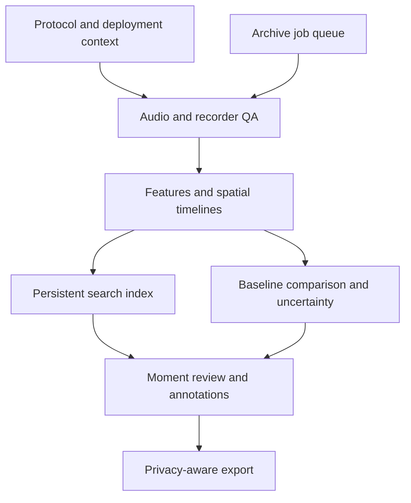

# From Recordings to Reviewed Evidence

These workflows extend the command-line toolkit from measurement into review,
comparison, curation, and repeatable archive operations. Start with a short
recording, inspect the artifacts, and then use the same declared parameters on
your archive. Each linked guide describes the command syntax, data contract,
assumptions, and limits of its implementation.

| Goal | Guide |
| --- | --- |
| Listen to selected moments and record labels | [Review packs](REVIEW_PACKS.md) |
| Compare new measurements with a baseline | [Monitoring](MONITORING.md) |
| Plot channel and spatial changes through time | [Spatial timelines](SPATIAL_TIMELINES.md) |
| Check clipping, dropouts, DC, and channel duplication | [Recorder QA](RECORDER_QA.md) |
| Search a persistent collection of feature vectors | [Feature store](FEATURE_STORE.md) |
| Estimate intervals and examine parameter sensitivity | [Uncertainty](UNCERTAINTY.md) |
| Record deployment and measurement context | [Protocols](PROTOCOLS.md) |
| Export reproducible embedding vectors | [Embedding backends](EMBEDDINGS.md) |
| Redact declared sensitive intervals with an audit record | [Privacy workflows](PRIVACY.md) |
| Claim archive jobs with leases and record completion | [Archive workers](ARCHIVE_WORKERS.md) |



## Choosing the Next Step

A recording can change because its sound sources changed, because the recorder
changed, or because the analysis changed. Keep those explanations separate in
your notes. Recorder QA identifies measurable waveform problems; protocol
metadata records facts the waveform cannot establish; monitoring compares
measurements under declared conditions. Listening and reviewing labels supply
additional evidence before a numerical result becomes a scientific claim.

Embedding similarity depends on its representation. A conventional spectral
vector measures spectral resemblance. A learned model can encode different
properties, depending on its training and preprocessing. Record the backend,
model identity, sample rate, feature names, and normalization with each index.

Redaction operates on the intervals supplied to it. Review the output and retain
the audit manifest; an unmarked interval is not evidence that speech or other
sensitive content is absent. Archive workers likewise expose explicit queue and
lease semantics: consult their guide before choosing a filesystem or deployment
topology.

See also [FrameTable contracts](ML_FEATURES.md), [calibration contracts](SCHEMA.md),
and [novelty semantics](NOVELTY_ANOMALY.md).

## Render These Guides

With the documentation extras and Playwright Chromium installed, render all ten
guides, their Mermaid diagrams, and their equations together:

```sh
python scripts/build_workflow_docs.py
```

The command creates individual pages and a combined HTML/PDF edition under
`docs/build/workflows/`. To build HTML without a browser installation, add
`--formats html`.
