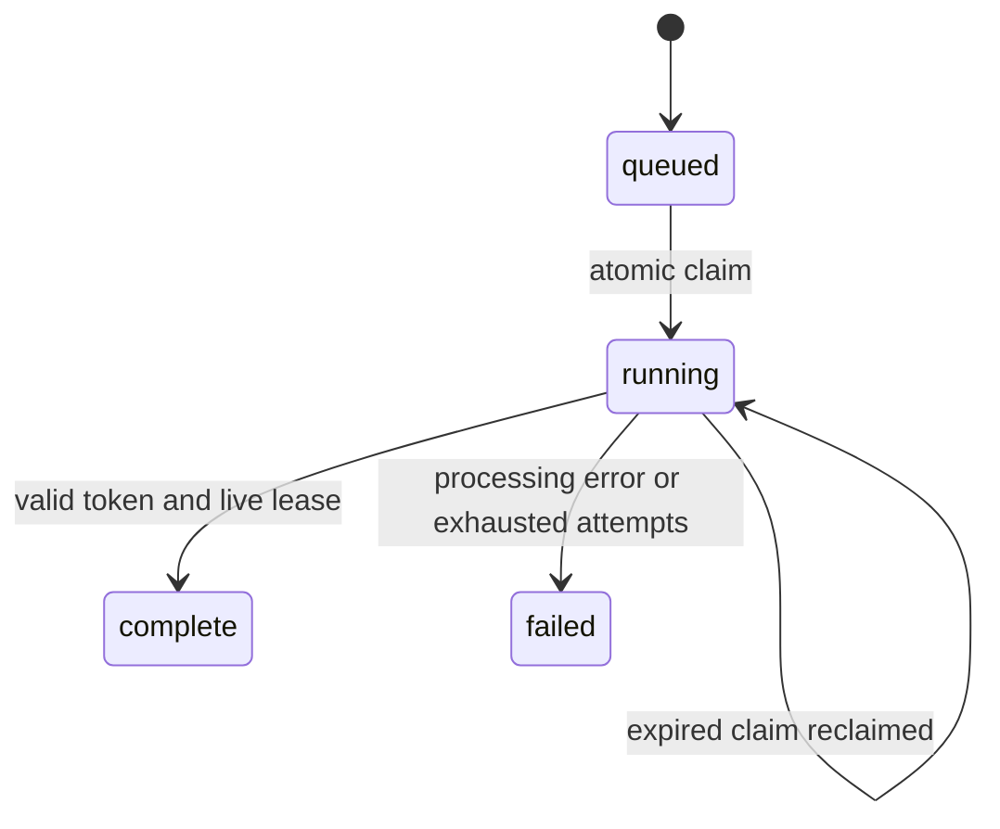

# Archive Workers and Object Storage

Use `archive-jobs` to turn a manifest of audio frame ranges into durable jobs.
Workers claim jobs, renew leases while processing, and store per-channel RMS and
peak summaries. PostgreSQL coordinates workers on multiple machines; SQLite
coordinates processes on one host using a local database file.

Install optional object-storage and PostgreSQL clients:

```sh
pip install 'ecosignallab[archive]'
```

## Local Example

Save this as `jobs.json`, with `recording.wav` beside it:

```json
{
  "schema_version": "1.0.0",
  "artifact_kind": "archive_job_manifest",
  "jobs": [
    {"uri": "recording.wav", "start_frame": 0, "stop_frame": 960000},
    {"uri": "recording.wav", "start_frame": 960000, "stop_frame": 1920000}
  ]
}
```

```sh
esl archive-jobs enqueue jobs.sqlite jobs.json
esl archive-jobs worker jobs.sqlite --owner worker-a --max-jobs 2 --lease-seconds 60
esl archive-jobs status jobs.sqlite > job-status.json
```

Frame ranges are half-open, zero-based, and measured in multichannel sample
frames, not interleaved scalar samples. Omit `stop_frame` to process to EOF.
Each job accepts only `uri`, `start_frame`, `stop_frame`, and optional `sha256`.
The checksum, when supplied, must be the lowercase SHA-256 of the entire source
file. Local relative URIs resolve beside the local manifest. A remote manifest
must contain absolute paths or object URIs.

## Multiple Machines

Provision a PostgreSQL server and use the same database URI on every worker:

```sh
export ESL_QUEUE_DSN='postgresql://esl@db.example.org/esl_queue'
esl archive-jobs enqueue "$ESL_QUEUE_DSN" jobs.json
esl archive-jobs worker "$ESL_QUEUE_DSN" --owner machine-a --max-jobs 100
esl archive-jobs worker "$ESL_QUEUE_DSN" --owner machine-b --max-jobs 100
esl archive-jobs status "$ESL_QUEUE_DSN"
```

Use your deployment's PostgreSQL authentication configuration. Avoid placing
passwords in shell history. Local paths in jobs must identify the same audio on
each machine; object URIs avoid dependence on matching local mounts. The queue
stores summaries in the database, so workers do not need a shared output folder.
Database schema creation requires permission to create `esl_archive_jobs`.

The PostgreSQL backend uses transactional row locks with
[`FOR UPDATE SKIP LOCKED`](https://www.postgresql.org/docs/current/sql-select.html)
and the database clock for lease comparisons. SQLite uses `BEGIN IMMEDIATE`
transactions and the host clock; consult
[SQLite transaction semantics](https://www.sqlite.org/lang_transaction.html).
Do not put a SQLite queue on a network filesystem to coordinate machines.

## Leases and Failure Semantics

A claim gets a fresh random token and expiry. A heartbeat renews it every third
of the lease duration. Completion succeeds only while that token still owns an
unexpired running claim. A replaced or expired worker cannot publish a result.

The acceptance rule can be written as:

$$
\mathrm{accept} = (q=\mathrm{running})\land(\tau=\tau_{\mathrm{stored}})
\land(t<t_{\mathrm{expiry}}).
$$

where $q$ is the job state, $\tau$ is the worker's claim token, $t$ is the
coordinator's current time, and $t_{\mathrm{expiry}}$ is the stored lease expiry.
Plain English: the worker must still hold the current, valid claim when it
commits. This is fencing, not exactly-once execution: work may be repeated after
a crash, but a stale result is rejected.



Enqueue is idempotent by the canonical job payload's SHA-256. Existing jobs are
retained. Expired claims are reclaimable until `--max-attempts` is exhausted;
processing errors are terminal failures. Workers stop when no job is currently
claimable or `--max-jobs` is reached; they are not polling daemons. A new worker
invocation can reclaim a subsequently expired lease. Keep the database durable
and back it up using its native tools.

## HTTP and S3 Sources

Manifests and audio can use `https://...` or `s3://bucket/key`. Explicitly add
`--allow-remote` on enqueue or worker commands that fetch remote data. S3 uses
the [Boto3 credential chain](https://boto3.amazonaws.com/v1/documentation/api/latest/guide/credentials.html).
Each object is staged to temporary local storage with a `--max-bytes` cap
(default 1 GB); remote reads are whole-object downloads, not range reads.
Ensure sufficient local temporary disk space. No public credentials or datasets
are bundled. The staging cap also applies to local source files.

## Measurements and Validation

The worker executes per-channel decoded-sample RMS and peak for each frame
range, using blocks of at most 65536 frames. It does not invoke the full metric
registry, novelty ranking, or a user-supplied executable. Results record source
hashes, exact frame range, sample rate, channels, and units. The entire source
file is hashed for every job, which can be expensive for many ranges in one
large file. Prefer physical shards for repeated archive analysis.

All reports have schema `1.0.0`, a distinct artifact kind, and esl version. Queue
status includes stored results and failures. The current suite checks local
claim races, retry limits, fencing, worker execution, and PostgreSQL SQL paths.
Set `ESL_TEST_POSTGRES_DSN` to enable the live PostgreSQL integration test; CI
provisions PostgreSQL 16 to exercise it. Optional S3 access still depends on your
deployment and credentials. See also [shard workflows](SHARD_WORKFLOWS.md) and
[protocol manifests](PROTOCOLS.md).
