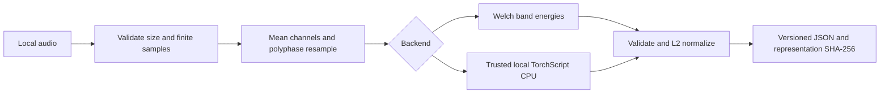

# Local Audio Embeddings

`esl embeddings` produces a portable, unit-length vector and explicit representation
provenance. It never downloads a model. All JSON reports use `schema_version: "1.0.0"`,
`artifact_kind: "audio-embedding"`, and the running `esl_version`.

```sh
esl embeddings recording.wav --output recording.embedding.json
esl embeddings recording.wav --backend spectral --sample-rate 16000 --dimensions 64
esl embeddings recording.wav --backend torchscript --model ./trusted-model.pt \
  --sample-rate 16000 --dimensions 128 --output model.embedding.json
```

The default backend is `spectral`; default sample rate is 16000 Hz and dimension is
64 for either backend. With TorchScript, explicitly set these to the model's contract.
`--max-seconds` defaults to 300. Files longer than this are rejected, not truncated.
Segment long recordings before embedding. Files must contain finite samples and
nonempty audio. Decoding is limited to 64 channels and 50 million total samples;
resampled mono audio is also limited to 50 million samples. These are sample-count
bounds, not a hard process-memory limit. Model memory and runtime are not bounded.
Both built-in backends accept target sample rates from 1000 through 192000 Hz.
Spectral vectors support 2 through 512 dimensions; TorchScript vectors support
1 through 65536 dimensions. All bounds are inclusive.

## Spectral Representation

Channels are averaged, then resampled using SciPy's
[polyphase low-pass resampler](https://docs.scipy.org/doc/scipy/reference/generated/scipy.signal.resample_poly.html).
The [Welch estimate](https://docs.scipy.org/doc/scipy/reference/generated/scipy.signal.welch.html)
uses 2048-sample Hann windows, 1024-sample overlap, no detrending, one-sided density
scaling, and arithmetic mean across frames. Audio shorter than 2048 samples is
zero-padded. Frequency bins are assigned to equally spaced bands from DC to Nyquist;
the Nyquist endpoint belongs to the last band.

$$
E_b = \sum_{k \in \mathcal{B}_b} P_k,
\qquad
r_b = \sqrt{E_b},
\qquad
z_b = \frac{r_b}{\sqrt{\sum_{j=0}^{D-1} r_j^2}}.
$$

Where:

- $D$ is the configured number of bands and embedding dimensions.
- $b$ and $j$ identify bands, numbered from zero through $D-1$.
- $\mathcal{B}_b$ is the set of frequency-bin indices assigned to band $b$.
- $P_k$ is the Welch power spectral density estimate at frequency bin $k$.
- $E_b$ is the summed band power, $r_b$ is its square root, and $z_b$ is the
  corresponding component of the normalized embedding.

In plain English, add the spectral power values within each band, take the square
root of each total, then divide every component by the Euclidean length of the
resulting vector. The common frequency
spacing factor cancels under normalization. Zero-energy audio has no cosine direction
and is rejected. This is a timbral/spectral baseline, not a species classifier or
semantic audio model. It discards absolute level and time order. Identical inputs and
configuration give deterministic results within the recorded dependency environment;
bitwise reproducibility across different hardware is not promised.

## Local TorchScript Contract

Install the existing `ml` extra (or compatible PyTorch) separately. The optional import
is lazy: spectral use does not import torch. The trusted local file is loaded on CPU
in evaluation mode, inference is run without gradients, and the wrapper accepts:

```text
input: float32 tensor [1, number_of_mono_samples]
output: finite nonzero tensor [dimensions] or [1, dimensions]
```

The wrapper performs only the same channel averaging/resampling as above followed by
L2 output normalization. It does not guess padding, crop duration, spectrograms,
tokenization, training normalization, or sample-rate expectations. Package any such
operations inside the supplied model. Fixed-duration models require correctly segmented
input. Stochastic operations inside a model can still be stochastic in evaluation mode.
Only load trusted files: serialized models can execute code. TorchScript is an optional
legacy interoperability backend, not a promise of support for arbitrary PyTorch models;
see [PyTorch serialization documentation](https://docs.pytorch.org/docs/stable/jit.html).

Provenance includes the model file SHA-256, torch version, CPU device, dimensions,
sample rate, preprocessing/normalization identifiers, and numerical/decoder dependency
versions. The file is hashed and loaded through the same open descriptor. Renaming an
unchanged model does not change its representation. Concurrent in-place modification
of model files is unsupported. No model path, weights download, or private remote
inference service is involved.

## Plugin Integration

```python
from pathlib import Path
from esl.workflows.embeddings import SpectralBackend, embed_file

backend = SpectralBackend(sample_rate=16000, dimensions=64)
record = embed_file(Path("recording.wav"), backend, max_seconds=300)
```

Custom backends implement `EmbeddingBackend`: a `config` property returning a JSON
object containing at least `sample_rate` and `dimensions`, and `embed(mono_audio)`
returning a vector. Include every representation-affecting setting and model checksum
in `config`; change your implementation version when behavior changes. Python plugins
are supported by the API; CLI choices deliberately remain spectral and TorchScript.

The representation ID is the full SHA-256 of sorted compact JSON configuration.
Configuration includes library versions, so upgrades intentionally require a new index
or complete re-embedding. A fingerprint verifies compatibility, not authenticity of
untrusted records. Source is a resolved local path, not an audio-content checksum.


