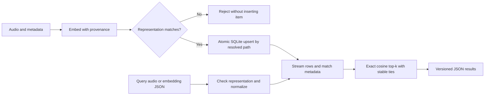

# Persistent Feature Store

The `index` command stores embeddings in a local SQLite database, with immutable
representation configuration, metadata, idempotent ingestion, and exact cosine search.
It is suitable for small-to-medium local collections, not a distributed vector service.
See [embedding backends](EMBEDDINGS.md) for model contracts and preprocessing.

## Commands

```sh
esl index ingest ./birds.sqlite morning.wav evening.wav --metadata '{"site":"park"}'
esl index info ./birds.sqlite
esl index query ./birds.sqlite --audio morning.wav --top-k 5 --filters '{"site":"park"}'
esl embeddings morning.wav --output morning.embedding.json
esl index query ./birds.sqlite --record morning.embedding.json --top-k 5
```

`ingest` and audio `query` accept `--backend`, `--model`, `--sample-rate`,
`--dimensions`, and `--max-seconds`, matching `embeddings`. A TorchScript collection:

```sh
esl index ingest ./model.sqlite morning.wav --backend torchscript \
  --model ./trusted-model.pt --sample-rate 16000 --dimensions 128
esl index query ./model.sqlite --audio evening.wav --backend torchscript \
  --model ./trusted-model.pt --sample-rate 16000 --dimensions 128 --top-k 10
```

Create the database's parent directory yourself. The database path is explicit; there
is no hidden cache or environment-dependent default. IDs are resolved absolute audio
paths. Rerunning ingestion replaces the vector and full metadata for that ID, without
adding a duplicate. Replacing audio at that path updates the entry on the next ingestion;
files are not watched. Moving a file creates another ID; deletion/garbage collection is
not exposed by this bounded CLI. Metadata `source` is reserved and always the resolved
audio path. Other keys are supplied by `--metadata` as a JSON object.

Each successful item is committed separately. If a later file fails, earlier items
remain; rerun the same command safely after fixing the failure. There is no all-files
atomic transaction or partial-success JSON report on error. SQLite transactions make
each individual upsert atomic, and parameter binding avoids metadata SQL interpolation;
see [Python's SQLite documentation](https://docs.python.org/3/library/sqlite3.html).
Use a local filesystem with SQLite locking support. The connection timeout is 30 seconds.
One `FeatureStore` object should be used on its creating thread; independent processes
can open their own connections. Back up a quiescent database or use SQLite backup tools.

## Compatibility And Reports

An index has one immutable representation. Opening it for ingestion compares the entire
canonical representation SHA-256, not just dimension. Querying also requires the exact
fingerprint. A changed model, dimension, preprocessing configuration, or recorded
numerical/decoder library version requires a separate database or full re-embedding.
There is no implicit conversion or automatic schema migration. Never mix calibrated
metrics, spectral vectors, and learned embeddings merely because they have equal length.

Reports use `schema_version: "1.0.0"`, `esl_version`, `representation`, and
`representation_id`. `artifact_kind` is `feature-index` for info/ingestion and
`feature-index-query` for queries. Ingestion also reports `ingested` (successful input
items, not new unique IDs). Queries include `filters`, `top_k`, and `results`, each with
`id`, `score`, and `metadata`. Database schema revision is internally integer 1 and is
independent of the public report version and existing analysis schemas.

`--record` consumes JSON from `esl embeddings` and validates its schema and representation
fingerprint. Do not edit a record's configuration to force compatibility: fingerprints
are not signatures and cannot establish that arbitrary supplied vectors are genuine.
Backend flags on a record query are unused because provenance comes from the record.

## Search And Filtering

```text
unit[i] = vector[i] / square root of sum over j of vector[j] squared
cosine_score = sum over i of query_unit[i] times stored_unit[i]
```

Where `i` and `j` enumerate vector dimensions, and `unit` denotes Euclidean-length-one
normalization. Nonfinite, wrong-shape, and zero vectors are rejected. The dot product
of unit vectors is [cosine similarity](https://docs.scipy.org/doc/scipy/reference/generated/scipy.spatial.distance.cosine.html)
(one minus SciPy's cosine distance),
clamped to [-1, 1] against rounding noise. Higher is better; negative is allowed. This
is similarity, not a calibrated probability or ecological confidence interval.

Filters are an AND of exact top-level JSON key/value comparisons. Missing and null are
different; boolean `true`, integer `1`, and float `1.0` are distinct. Nested values may
be compared as complete canonical JSON, but there are no nested paths, ranges, text
search, or SQL expressions. A query may return fewer than `top_k` items or none.

Search scans database rows incrementally and keeps at most `top_k` candidates; `top_k`
must be 1..10000. Equal scores sort by ascending ID. Time is linear in collection size
times vector dimension, with top-k selection overhead; memory is proportional to the
requested results and individual row sizes, not all vectors. Metadata filtering also
scans rows: it is not an indexed metadata query or ANN algorithm. Large metadata objects
remain caller-controlled. Stored vectors are normalized little-endian float64 blobs.

## Python Integration

```python
from pathlib import Path
from esl.workflows.embeddings import SpectralBackend, embed_file
from esl.workflows.feature_store import FeatureStore

backend = SpectralBackend()
record = embed_file(Path("morning.wav"), backend)
with FeatureStore(Path("birds.sqlite"), backend.config) as store:
    store.upsert(record["source"], record["vector"], {"site": "park"},
                 representation=record["representation_id"])
    matches = store.query(record["vector"], representation=record["representation_id"],
                          top_k=5, filters={"site": "park"})
```

CLI integration calls `feature_store.register(subparsers)` and
`embeddings.register(subparsers)`, each setting `args.func(args)` to a handler returning
zero on success. Exceptions propagate to the main CLI's existing error handling.


