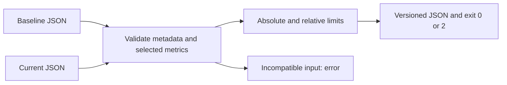

# Baseline-Current Monitoring

`esl monitor compare` is an offline, deterministic threshold comparator, not a
background service, statistical change detector, or regulatory compliance test.
It never selects a threshold on the user's behalf.

```sh
esl monitor compare baseline.json current.json \
  --threshold rms_dbfs=3 --output comparison.json
esl monitor compare baseline.json current.json \
  --relative-threshold spectral_centroid_hz=0.10 --allow-uncalibrated
```

Use repeated `--threshold METRIC=VALUE` for absolute limits in the metric's units.
Use repeated `--relative-threshold METRIC=FRACTION` for fractional limits (0.10 means
10 percent, not 0.10 percent). Both limits must pass when both are supplied.
Negative, duplicate, missing, and nonfinite thresholds are errors. Only metrics
named in these options are compared. `--statistic mean` selects the summary key;
other existing numeric summary keys can be selected explicitly.

## Input And Compatibility

Native analysis reports use `metadata.calibration` and `metrics.NAME` objects with
`units`, `summary`, and optional `spec`. Compact metric reports are also supported:

```json
{"metrics": {"temperature": 21.5}}
```

Compact or uncalibrated reports require `--allow-uncalibrated`; results explicitly
label calibration as `unverified`. A metric whose specification declares
`calibration_dependency: true` still requires calibration, even with this flag.
Calibration objects must be nonempty and exactly equal. A mismatch cannot be
silently overridden. This checks recorded metadata, not calibration validity,
traceability, or instrument drift.

Sample rate, channel count, frame size, hop size, source schema version, metric
units and complete metric specifications must match when supplied. A field
missing on only one side is incompatible; missing on both sides remains
unverified. Calibration/units are not inferred from filenames or metric names.
Calibration payloads with irrelevant differences are conservatively rejected.
Native pipeline hashes include file paths, so equality would reject separate
recordings; they are deliberately not used as a compatibility criterion.
Other analysis settings, site identity, sensor positioning, and environmental
conditions remain the operator's responsibility. No reweighting or recalibration
is performed, and a scalar metric has no verified units.

## Decision Rule

`delta = current - baseline` is the signed change, where current and baseline
are the selected summary values. An absolute threshold passes when
`abs(delta) <= absolute_threshold`, where the threshold is in metric units.

`relative_change = abs(delta) / abs(baseline)`, where relative change is a
nonnegative fraction. A relative threshold passes when this fraction is no larger
than the selected threshold. If baseline is zero, relative change is JSON null:
unchanged zero passes, and any nonzero change alerts. Equality at a limit passes.
Relative thresholds for logarithmic dB metrics are usually not physically useful;
prefer absolute dB differences. These arithmetic rules are not significance tests.

## Output And Exit Codes

Reports identify `artifact_kind: esl.monitor.comparison`, `schema_version: 1.0.0`,
and `esl_version`. They include thresholds, selected statistic, signed deltas,
pass/alert decisions, calibration status, limitations and source paths/SHA-256
hashes. Inputs are rechecked for modification before output. `--output PATH`
writes JSON; otherwise JSON goes to stdout. Parent directories must already exist.

Exit 0 means every selected threshold passes. Exit 2 means at least one alert
(the JSON report is still emitted). Through the main CLI, invalid input exits 1.
Do not treat exit 2 as malformed input. Missing metrics and nonfinite numbers
fail rather than being silently skipped. No files are changed except the requested
output; choose an output path distinct from your input files.



## Python Integration

```python
from esl.workflows.monitor import compare_reports, register

result = compare_reports(baseline, current, {"rms_dbfs": 3.0},
                         allow_uncalibrated=True)
# Parent CLI: register(subparsers)
```
