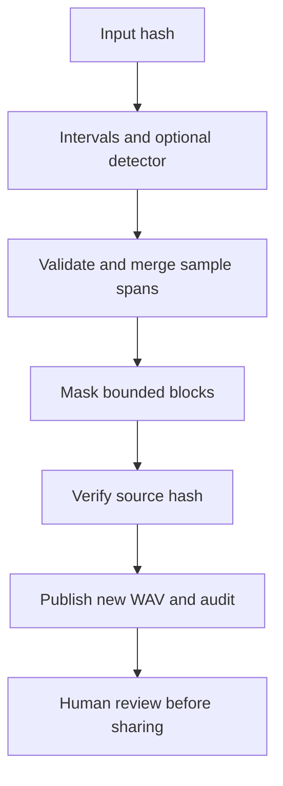

# Audited Interval Redaction

This workflow silences declared time intervals across every channel and writes
an audit record. It is useful when a reviewer has identified speech, names,
location clues, or other material that should be masked in a shared copy.
Keep the original recording separately and review the exported copy.

Create `intervals.json` with decimal seconds:

```json
[
  {"start": 12.25, "end": 15.75},
  {"start": 40.0, "end": 42.5}
]
```

Then run:

```sh
esl privacy redact input.wav shared.wav --intervals intervals.json --audit audit.json
```

The input, output, and audit paths must be distinct, and both output paths must
be new. Their parent directories must exist. Unsupported formats or unavailable
decoders fail explicitly; this command uses SoundFile rather than the FFmpeg
fallback. Output preserves sample rate, channel count, duration, and decoded
samples outside the masked spans using double-precision lossless encoding.

## Exact Interval Semantics

An interval covers every sample touched by its requested duration. Start times
round down and end times round up; the right endpoint is excluded:

$$
a = \lfloor f_s t_{\mathrm{start}} \rfloor, \qquad
b = \lceil f_s t_{\mathrm{end}} \rceil, \qquad
y_c[n] = \begin{cases}0,& a \leq n < b,\\ x_c[n],&\text{otherwise.}\end{cases}
$$

where $f_s$ is sample rate, $t_{\mathrm{start}}$ and $t_{\mathrm{end}}$ are
seconds, $a$ and $b$ are sample indices, $c$ identifies a channel, $x$ is decoded
input, and $y$ is the redacted output. Plain English: all channels are zeroed over
the same conservatively rounded span; audio elsewhere retains its decoded value.
Overlapping or touching spans are merged before processing.

Endpoints are parsed as exact decimal values and converted using rational
arithmetic. This avoids a floating-point rounding error turning an exact sample
boundary into an extra sample. Intervals must have exactly `start` and `end`,
with finite $0 \leq t_{\mathrm{start}} < t_{\mathrm{end}}$ within the recording.
Invalid intervals fail rather than being silently clipped. See Python's
[Decimal](https://docs.python.org/3/library/decimal.html) and
[Fraction](https://docs.python.org/3/library/fractions.html) documentation for the
arithmetic representations; the masking implementation is original esl code.

## Detector Hooks

For automated candidate intervals, provide a trusted Python function:

```sh
esl privacy redact input.wav shared.wav --detector my_detector:find_intervals \
  --audit audit.json
```

The function receives a `Path` to the original input and returns dictionaries
with `start` and `end` in seconds. It can be combined with `--intervals`; esl
merges their union. The hook runs local Python code and controls its own model,
memory, accuracy, and runtime. No speech recognizer is bundled. A detector result
is a candidate for review, not evidence that all sensitive content was found.

## Audit and Publication

The audit includes schema `1.0.0`, artifact kind `privacy_redaction`, esl version,
source and output SHA-256 hashes, detector identity, requested intervals, exact
sample spans, encoding, channel count, and masked-frame count. A second source
hash check detects a file changed during processing. Audio is processed in bounded
blocks; hashing still reads the full file. RF64 is used when the resulting data
would exceed classic WAV capacity; consult the [large-file guide](RF64_AND_LARGE_FILES.md).
The default is 65536 frames per read. Use `--block-frames` to reduce this for
large channel counts; each read is limited to 1048576 scalar channel samples.



Temporary files are staged beside the outputs, then published without replacing
existing paths. This requires filesystem support for hard links. The two-file
publication is not a single filesystem transaction; errors trigger cleanup.
Abrupt process termination may require removing staged files manually.

Masking is abrupt zeroing, with no fade or crossfade, so boundary clicks are
possible. It does not remove context, guarantee anonymization, encrypt data,
change access permissions, or establish consent. The audit itself contains source
paths and interval locations and may need restricted access. Record your policy
in a [protocol manifest](PROTOCOLS.md).
