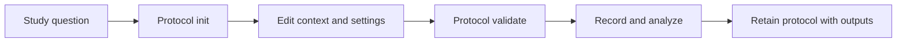

# Measurement Protocol Manifests

A protocol records what you intended to measure and the conditions needed to
interpret it. Create one before recording, retain it with the audio, and validate
it after editing. This preserves context that cannot be reconstructed from a WAV
file, such as microphone placement, consent, and the calibration procedure.

```sh
esl protocol init field-study.json --name "Dawn survey" --author "Field team" \
  --sample-rate 96000 --channels 4 --site "Site A" \
  --deployment "Fixed recorder, 2 m above ground, UTC clock" \
  --microphone "FOA microphone; recorder gain 20 dB" \
  --channel-label W --channel-label Y --channel-label Z --channel-label X \
  --calibration "calibration.yaml; verification recorded before deployment" \
  --consent "Permission record held by study team; review speech before export"
esl protocol validate field-study.json
esl protocol schema > protocol.schema.json
```

Initialization creates a new file exclusively; it refuses to overwrite an existing
protocol. It defaults to 48000 Hz, one channel, a one-second window, a half-second
hop, `rms_dbfs`, and privacy policy `none`. Edit the JSON to declare your intended
metrics, window, hop, description, and privacy policy, then validate again.

## Contract

Required top-level fields are `schema_version: "1.0.0"`,
`artifact_kind: "measurement_protocol"`, `esl_version`, `name`, `config`, and
`provenance`. Provenance contains `author` and `description`. Configuration
contains `sample_rate`, `channels`, `window_seconds`, `hop_seconds`, `metrics`,
and `privacy_policy`. The privacy policy is `none`, `supplied-intervals`, or
`detector-review`. These labels record intended policy; they do not execute it.

Optional `context` contains `site`, `deployment`, `microphones` (a list),
`channel_layout` (a list), `calibration`, and `consent`. Channel labels must be
unique and their count must match `config.channels`. Microphone entries must also
be unique. Calibration is a human-readable reference to the measurement record;
it does not replace the numeric [analysis calibration contract](SCHEMA.md).

Unknown keys and duplicate JSON object keys are rejected. Numeric values must be
finite; sample rate and channel count must be positive integers. The validator
implements the small vocabulary used by its exported
[JSON Schema](https://json-schema.org/draft/2020-12); it is not a general schema
engine. Metric IDs are recorded as strings, not resolved against a plugin registry.
Consult the [metrics reference](METRICS_REFERENCE.md) for executable IDs.

## Time-Scale Checks

The hop must advance by at least one sample and cannot exceed the window.
This prevents gaps in the declared frame coverage and prevents a zero-sample hop:

$$
0 < T_h \leq T_w, \qquad f_s T_h \geq 1.
$$

where $T_h$ is the hop duration in seconds, $T_w$ is the window duration in
seconds, and $f_s$ is sample rate in samples per second. Plain English: each
frame advances through the signal, and successive declared windows overlap or
meet. The protocol stores durations; the analysis engine resolves its own sample
counts when you pass corresponding options.



Validation checks structure and internal consistency. It does not verify a
microphone, grant consent, certify calibration, or automatically apply the
protocol to `esl analyze`. Pass matching analysis options explicitly and retain
the resolved analysis report. Use [QA](RECORDER_QA.md) and
[privacy redaction](PRIVACY.md) for the corresponding executable checks.
