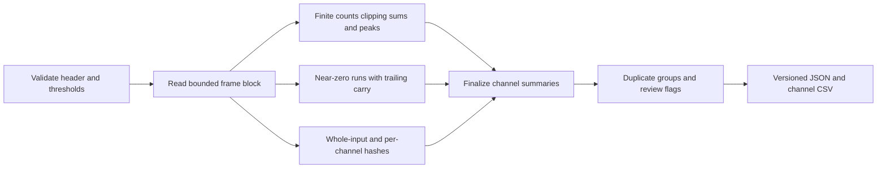

# Recorder Quality Assurance

`qa` streams N-channel recordings and reports clipping candidates, near-zero
dropout candidates, whole-recording DC offsets, invalid samples, and exact channel
duplication. It writes `recorder_qa.json` and one-row-per-channel `recorder_qa.csv`.

```bash
esl qa recording.wav --out-dir results/qa
esl qa recording.wav --out-dir results/qa --block-frames 32768 \
  --clip-threshold 0.999 --dropout-threshold 0.000001 \
  --min-dropout-seconds 0.1 --dc-threshold 0.01 --fail-on-flags
```

The default exit code is zero after successful analysis, even with findings.
`--fail-on-flags` returns two when `status` is `review`, allowing CI pipelines to
gate exports. Input/processing failures are handled by the parent CLI separately.
`no_flags` means only that these checks did not flag, not that audio is fault-free.

## Checks and Formulas

```text
clipped_samples = count(finite(x) and abs(x) >= clip_threshold)
clipped_fraction = clipped_samples / total_frames
near_zero_samples = count(finite(x) and abs(x) <= dropout_threshold)
dropout_flag = longest_near_zero_run >= ceil(min_dropout_seconds * sample_rate)
dc_mean_fs = sum(finite samples) / count(finite samples)
dc_flag = abs(dc_mean_fs) > dc_threshold
peak_fs = max(abs(finite samples))
```

Where `x` is a channel's decoded digital sample, `finite` excludes NaN and
infinities, and `count` counts samples. Levels and DC are expressed relative to
digital full scale, not pascals. All channels are analyzed independently. Zero
denominators yield null rather than NaN or infinity. The clipped fraction uses all
frames, including invalid frames; `nonfinite_samples` is reported separately.

Dropout run lengths are exact across block boundaries, not rounded to block
duration. Both the total near-zero sample count and longest contiguous run are
reported. A short zero crossing is counted but does not flag unless its contiguous
run meets the configured minimum duration. Invalid samples break a near-zero run.
There is no unbounded event list and no per-event timestamp export in this scope.

Exact duplicate detection hashes each complete decoded channel using SHA-256.
Signed zeros are normalized, so +0 and -0 are equal. Finite channels with matching
hashes are returned as groups of zero-based channel indices. Empty channels and
channels containing invalid samples are excluded. Silent channels can duplicate;
gain-scaled, delayed, lossy, or merely highly correlated channels do not qualify.
This is hash-based exact matching, not a similarity or perceptual detector.
See the [Python hashlib documentation](https://docs.python.org/3/library/hashlib.html)
for SHA-256 semantics; digest collisions are theoretically possible.

## Artifacts and Provenance

The JSON envelope contains `schema_version: "1.0.0"`,
`artifact_kind: "recorder_qa"`, `esl_version`, `provenance`, `config`, `status`,
per-channel `channels`, `duplicate_channel_groups`, `clock_drift`, and
`limitations`. CSV contains the per-channel scalar diagnostics and flags.

Provenance includes the resolved source path, byte size, modification time,
sample rate, channel count, frame count, container format/subtype and a SHA-256
of decoded float64 little-endian interleaved samples. This identifies analyzed
samples, not encoded file bytes or cryptographic chain of custody. The source
size and modification time are checked again before outputs are written.
Source audio is not rewritten. Fixed output names replace older reports in the
selected output directory; use separate directories to preserve previous runs.



## Bounds and Limitations

Memory depends on channel count and `--block-frames`, not recording duration.
The default block is 65,536 frames and the hard cap is 4,194,304 scalar samples
across all channels per block. Oversized blocks are rejected before decoding.
Statistics and hash state are proportional to the channel count; duplicate
grouping avoids a quadratic pairwise correlation matrix. Counts use signed
64-bit integers. DC summation uses float64, so very long recordings can accumulate
floating-point rounding error. Chunk-size changes may affect final DC rounding,
but not run counts or the decoded hash.

- Clipping flags samples at the threshold, not confirmed overload or ADC damage.
  Integer PCM often reaches a positive maximum slightly below 1; the default
  0.999 threshold intentionally includes such samples. Floating audio can exceed 1.
- This is not a true-peak/intersample detector and does not implement a loudness
  standard. Sample peak and true peak are distinct measurements, as documented
  in [ITU-R BS.1770](https://www.itu.int/rec/R-REC-BS.1770/en).
- Intentional silence can produce dropout flags; quiet ambient audio can do so
  if the threshold is set too high. No packet log or hardware diagnostics are read.
- Whole-recording DC can miss short offsets that cancel over the recording.
  It is not a high-pass-filter response or hardware calibration measurement.
- Exact duplication may be intentional routing. No near-duplication, crosstalk,
  phase inversion, frequency response, or sample-slip detector is provided.
- Clock drift is explicitly `not_assessed`: a single recording without an
  external timing/reference signal cannot establish recorder clock drift.
- Empty recordings receive `review`, no duplicate groups, null means/peaks,
  and zero counts. Invalid samples receive separate counts and trigger review.

## Python Integration

```python
from esl.workflows import qa

qa.register(subparsers)
report = qa.recorder_qa("recording.wav", "results/qa", block_frames=32768)
```

`register` installs the `qa` parser and its `args.func(args)` handler. The Python
function returns the same report that is written to JSON. Tests:
`tests/test_workflow_qa.py`.
