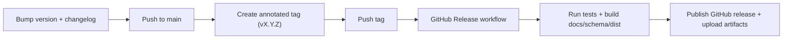

# Release Process

Quick links: [Docs Index](INDEX.md) | [Getting Started](GETTING_STARTED.md) | [Task Recipes](TASK_RECIPES.md) | [Troubleshooting](TROUBLESHOOTING.md) | [Schema](SCHEMA.md) | [Metrics](METRICS_REFERENCE.md) | [References](REFERENCES.md)

This runbook describes how to cut an `esl` release and publish build artifacts (wheel/sdist, docs HTML/PDF, schema JSON).

## Preconditions

- Working tree is clean.
- `CHANGELOG.md` has updated release notes.
- `pyproject.toml` and `src/esl/version.py` contain the target version.
- Docs links are current, including workflow references like [`docs/MOMENTS_EXTRACTION.md`](MOMENTS_EXTRACTION.md).
- Tests pass locally:

```bash
.venv/bin/pytest -q
```

## v0.3.0 Release

`main` is now prepared with package/runtime version `0.3.0`. The
analysis-output JSON schema remains version `0.2.0`: schema versioning is
independent of package versioning, and its contract has not changed for this
release. Do not rename or regenerate a `0.3.0` schema artifact unless the
schema itself changes.

Before cutting the tag:

- Confirm `CHANGELOG.md` no longer says `Unreleased` for `0.3.0` and accurately
  reflects the final commit range.
- Run `pytest -q`, `ruff check .`, and the documentation/textbook rebuild.
- Verify `python -m esl --version` reports `0.3.0` and `esl schema` still
  reports schema version `0.2.0`.
- Confirm the release commit is on `main` and the working tree is clean.
- Review the GitHub Actions release workflow before pushing the tag; a tag
  triggers publication of distributions, documentation bundles, and the current
  schema artifact.

### Current Verification Status

The v0.3.0 package/runtime bump, repository-wide `ruff check .`, full test suite,
textbook rebuild, and source/wheel build have been verified. The changelog is
dated 2026-10-15, with curated [release notes](releases/v0.3.0.md). The release
workflow reads `docs/releases/<tag>.md` when publishing a tagged release.
Run the workflow manually on `main` as a preflight before creating the tag.

## Release Flow



## Commands

1. Verify version consistency:

```bash
python - <<'PY'
import tomllib
from pathlib import Path
from esl import __version__
py = tomllib.loads(Path("pyproject.toml").read_text(encoding="utf-8"))
print("pyproject:", py["project"]["version"])
print("runtime:", __version__)
PY
```

2. Create and push a tag:

```bash
git tag -a v0.3.0 -m "ecoSignalLab v0.3.0"
git push origin v0.3.0
```

3. Monitor GitHub workflow:
- [`Release`](../.github/workflows/release.yml)

## Workflow Outputs

The release workflow publishes:

- `dist/*.whl`
- `dist/*.tar.gz` (sdist)
- `docs-build-html.tar.gz`
- `docs-build-pdf.tar.gz`
- `docs/schema/analysis-output-<schema_version>.json`

## Notes

- The workflow checks that `vX.Y.Z` tag matches package runtime version.
- PDF generation requires Playwright Chromium in CI.
- For manual smoke without a tag, run `workflow_dispatch` from GitHub Actions.

## PyPI Publication

The dedicated [PyPI workflow](../.github/workflows/pypi.yml) downloads the wheel
and sdist from a published GitHub release, verifies their GitHub SHA-256 digests
and package metadata, runs `twine check --strict`, then uploads those exact files.
The publisher job receives an OIDC token; no build scripts run in that job.
The workflow also runs after successful tagged Release workflows. Manual runs
accept an existing stable tag so publication does not require moving or recreating it.

Version [0.3.0](https://pypi.org/project/ecosignallab/0.3.0/) was published on
2026-10-16. A fresh PyPI installation and `esl --version` were verified.
The Trusted Publisher is configured with these values:

| Field | Value |
| --- | --- |
| PyPI project | `ecosignallab` |
| GitHub owner | `TheColby` |
| Repository | `ecoSignalLab` |
| Workflow filename | `pypi.yml` |
| Environment | `pypi` |

For a future release, substitute its published GitHub release tag below:

```sh
gh workflow run pypi.yml --ref main -f tag=vX.Y.Z
```

The first upload created the PyPI project; do not add another pending publisher
for subsequent releases. Manage the existing publisher in the project settings.
After each publication, check the [project page](https://pypi.org/project/ecosignallab/)
and install the new version in a fresh environment, then run `esl --version`
and `esl doctor`. Versions on PyPI are immutable: do not rebuild or replace
files under an already-published version. Re-running an already successful
publication deliberately fails rather than silently skipping existing files.
See [PyPI's Trusted Publishing guide](https://docs.pypi.org/trusted-publishers/using-a-publisher/).
