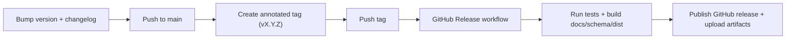

# Release Process

Quick links: [Docs Index](INDEX.md) | [Getting Started](GETTING_STARTED.md) | [Task Recipes](TASK_RECIPES.md) | [Troubleshooting](TROUBLESHOOTING.md) | [Schema](SCHEMA.md) | [Metrics](METRICS_REFERENCE.md) | [References](REFERENCES.md)

This runbook describes how to cut an `esl` release and publish build artifacts (wheel/sdist, docs HTML/PDF, schema JSON).

## Preconditions

- Working tree is clean.
- `CHANGELOG.md` has updated release notes.
- `pyproject.toml` and `src/esl/version.py` contain the target version.
- Docs links are current, including workflow references like [`docs/MOMENTS_EXTRACTION.md`](MOMENTS_EXTRACTION.md).
- Tests pass locally:

```bash
.venv/bin/pytest -q
```

## v0.3.0 Preparation

`main` is now prepared with package/runtime version `0.3.0`. The
analysis-output JSON schema remains version `0.2.0`: schema versioning is
independent of package versioning, and its contract has not changed for this
release. Do not rename or regenerate a `0.3.0` schema artifact unless the
schema itself changes.

Before cutting the tag:

- Confirm `CHANGELOG.md` no longer says `Unreleased` for `0.3.0` and accurately
  reflects the final commit range.
- Run `pytest -q`, `ruff check .`, and the documentation/textbook rebuild.
- Verify `python -m esl --version` reports `0.3.0` and `esl schema` still
  reports schema version `0.2.0`.
- Confirm the release commit is on `main` and the working tree is clean.
- Review the GitHub Actions release workflow before pushing the tag; a tag
  triggers publication of distributions, documentation bundles, and the current
  schema artifact.

### Current Verification Status

The v0.3.0 package/runtime bump, repository-wide `ruff check .`, full test suite,
textbook rebuild, and source/wheel build have been verified. The remaining tag
decision is release governance: finalize the changelog date and commit range,
confirm the release commit is on `main`, then create the annotated tag.

## Release Flow



## Commands

1. Verify version consistency:

```bash
python - <<'PY'
import tomllib
from pathlib import Path
from esl import __version__
py = tomllib.loads(Path("pyproject.toml").read_text(encoding="utf-8"))
print("pyproject:", py["project"]["version"])
print("runtime:", __version__)
PY
```

2. Create and push a tag:

```bash
git tag -a v0.3.0 -m "ecoSignalLab v0.3.0"
git push origin v0.3.0
```

3. Monitor GitHub workflow:
- [`Release`](../.github/workflows/release.yml)

## Workflow Outputs

The release workflow publishes:

- `dist/*.whl`
- `dist/*.tar.gz` (sdist)
- `docs-build-html.tar.gz`
- `docs-build-pdf.tar.gz`
- `docs/schema/analysis-output-<schema_version>.json`

## Notes

- The workflow checks that `vX.Y.Z` tag matches package runtime version.
- PDF generation requires Playwright Chromium in CI.
- For manual smoke without a tag, run `workflow_dispatch` from GitHub Actions.
