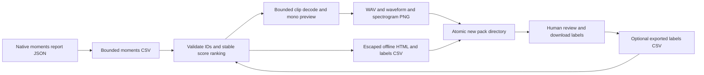

# Review Queues and Annotation Packs

Create an offline, portable annotation queue from existing `esl moments extract`
or `esl shard moments` outputs. Both native `moments_report.json` (including
archive reports) with a `csv_path` field and native moments CSVs are supported.
CSV rows must contain unique `clip_id` values and an existing `wav_path`.
Clip IDs must be trimmed and cannot begin with spreadsheet formula characters.
Existing extracted clips are required: this command does not regenerate missing
clips from a source recording or an archive.

## Commands

Run from the repository with its virtual environment installed:

```sh
.venv/bin/esl moments extract input.wav --out moments --top-k 20
.venv/bin/esl review moments/moments_report.json --out review-pack \
  --max-items 20 --preview-seconds 15
# Identical alias, when registered by the main CLI:
.venv/bin/esl moments review moments/moments.csv --out review-pack-alias \
  --max-items 20 --preview-seconds 15
open review-pack/index.html
```

`index.html` opens directly in a browser without a server, network access, CDN,
JavaScript dependencies, or `fetch` requests. Audio and PNG references are relative.
Copy the **entire directory**, not just its HTML, to transfer a pack. Browser
JavaScript is needed only for exporting edits; media and the initial CSV work
without it. Generated filenames are numeric, never derived from clip IDs.

The queue is ordered by descending finite `rank_score`, with stable input order
for ties; absent scores default to zero. Scores are not confidence estimates.
Each row includes its original event start/end times, an audio preview, waveform,
spectrogram, status, free-text label, and notes. Status is one of `pending`,
`accepted`, `rejected`, or `uncertain`. No label ontology or automatic classification
is imposed. Rejected items remain in the export for auditing.

Change labels in the page, then select **Download labels.csv** before closing it.
Edits are **not autosaved** and cannot overwrite files through the static browser
page. A CSV editor can also edit the initial `labels.csv` directly. Resume by
building a new directory with an exported annotations file:

```sh
.venv/bin/esl review moments/moments_report.json --out review-pack-resumed \
  --labels review-pack/labels.csv --max-items 20 --preview-seconds 15
```

Pass the browser's downloaded CSV path instead if labels were edited in the page.
Existing output directories are refused, including empty directories. Unknown or
duplicate annotation IDs and unsupported statuses are errors. Partial annotation
files are allowed: missing IDs remain pending. IDs match within this input manifest,
not across unrelated recordings; reuse the original manifest when resuming.
Only selected rows are included in the new pack and CSV, so changing `--max-items`
can omit prior annotations from the export. Keep the original label file.

## Artifacts and Bounds

- `index.html`: escaped metadata, editable annotations, and CSV download control.
- `labels.csv`: `clip_id,start_s,end_s,rank_score,status,label,notes`.
- `assets/item_NNNN.wav`: PCM16 mono preview, with no gain normalization.
- `assets/item_NNNN_waveform.png` and `assets/item_NNNN_spectrogram.png`.
- `review_manifest.json`: semantic `schema_version: "1.0.0"`, separate
  `artifact_kind: "review_pack"`, `esl_version`, provenance, config, item count,
  candidate count, original IDs and times, annotation state, relative asset paths,
  and actual preview durations. This is not the analysis schema.

Defaults are 100 items and the first 30 seconds of each clip. The allowed range
is 1-1000 items and greater than zero up to 120 preview seconds. Each clip is
additionally capped at 4,000,000 frames and supports at most 32 channels and
384,000 Hz. Actual duration is recorded per item; it may be shorter than requested.
Audio is decoded in blocks of at most 65,536 frames, then retained as a mono
preview for plotting. Memory is bounded by one preview, its spectral transform,
and metadata, not the duration of the original recording. Packs can nevertheless
be large at the upper item/duration limits; choose smaller limits for sharing.

Each JSON or CSV input is bounded to 16 MiB before parsing; CSVs support at most
10,000 rows (including annotation imports). All candidate scores and IDs are
validated before selection, but only selected audio is opened. A malformed or
missing selected clip aborts the build; no partial destination is published.
Builds use a temporary sibling directory and rename on success. A failed build
cleans up its own temporary files, and never modifies original audio/manifests.
Do not run simultaneous builds targeting the same output directory.

Paths are resolved relative to the containing manifest/CSV first; a current
working directory fallback supports native exporters that saved invocation-relative
paths. Absolute paths are supported. **Only use trusted input manifests**: these
references intentionally permit reading local files outside the manifest folder.
The JSON provenance records absolute input paths, so inspect it before sharing a
pack where filesystem paths are sensitive. The pack includes audible recording
content and annotations; it is not a redaction/privacy system.

HTML text and attributes are escaped. No user metadata is embedded in executable
JavaScript. CSV export prefixes an apostrophe on cells whose first non-whitespace
character is `=`, `+`, `-`, or `@`, reducing spreadsheet formula injection risk.
This prefix is retained literally on reimport, rather than guessing whether an
apostrophe is original annotation content. Such prefixes may also appear on
negative numeric metadata in CSV; original values remain in JSON/HTML.

## Signal Definitions

Previews use the arithmetic channel mean:

`mono[n] = (x_1[n] + ... + x_C[n]) / C`,

where `n` is the sample index, `C` is the number of input channels, and `x_c` is
channel `c` in full-scale digital amplitude. This is not a spatial mix: opposite
polarity channels can cancel. Playback is PCM16 and can clip if source amplitudes
exceed digital full scale. No calibrated SPL or diagnostic multichannel fidelity
is claimed; use the original clips for quantitative analysis.

The waveform shows minimum and maximum amplitude per contiguous bin, using at
most 1200 bins. This preserves brief peaks unlike selecting one sample per bin.

The spectrogram uses Hann-windowed short-time Fourier transforms, with window
length `N = min(1024, preview_frames)`, 50% integer overlap, no detrending, and
one-sided power spectral density scaling. In plain English, each short overlapping
window is tapered before transforming into frequency bins; squared magnitudes
are normalized by sample rate and window energy. For non-DC/non-Nyquist bins:

`P[k,t] = 2 * |FFT(window * segment)[k]|^2 / (sample_rate * sum(window^2))`,

where `k` is frequency-bin index and `t` is time-window index. DC and Nyquist
bins are not doubled. Display values are `10 * log10(max(P, 10^-12))` in
`dB FS^2/Hz`, not dB SPL. Adjacent time columns are max-pooled if there are more
than 1200, retaining high-energy events in the overview. Color scale is per clip,
not a calibrated comparison between clips. The implementation uses
[SciPy's spectrogram density normalization](https://docs.scipy.org/doc/scipy/reference/generated/scipy.signal.spectrogram.html),
retaining compatibility with the project's SciPy >=1.10 baseline; this API is
legacy but supported, not a new dependency on newer `ShortTimeFFT` releases.



## Integration and Verification

The main CLI should call these registration functions on its existing argparse
subparser actions; each command sets the existing `args.func(args)` contract:

```python
from esl.workflows import review

review.register(subparsers)          # esl review
review.register_moments(pmom_sub)     # esl moments review
```

Programmatic use:

```python
from pathlib import Path
from esl.workflows.review import build_review_pack

page = build_review_pack(
    Path("moments/moments_report.json"), Path("review-pack"),
    max_items=20, preview_seconds=15.0,
)
print(page)
```

Focused tests do not depend on other workflow modules being installed:

```sh
.venv/bin/python -m pytest tests/test_workflow_review.py
.venv/bin/ruff check src/esl/workflows/review.py tests/test_workflow_review.py
```
