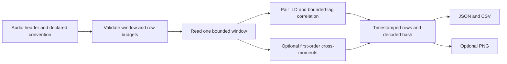

# Spatial Timelines

`spatial-timeline` reads non-overlapping windows from an N-channel audio file
without loading the recording into memory. It exports `spatial_timeline.csv`,
`spatial_timeline.json`, and, with `--plot`, `spatial_timeline.png`.

```bash
esl spatial-timeline recording.wav --out-dir results/spatial --window-seconds 1 \
  --pair 0 1 --max-itd-ms 1 --plot
esl spatial-timeline ambix.wav --out-dir results/ambix \
  --ambisonics acn-sn3d --window-seconds 0.25 --plot
```

Channel indices are zero-based. The selected pair must contain distinct channels.
No convention is inferred from channel count, filename, or container metadata.
Without `--ambisonics`, only pair ILD/ITD/correlation are populated.

## Signal Definitions

The accepted declarations are `acn-sn3d`, `acn-n3d`, and first-order `fuma`.
The first four channels are mapped to pressure-like `p` and directional components
`v = [X, Y, Z]`:

| Convention | Stored order | Conversion to working components |
| --- | --- | --- |
| ACN/SN3D | W, Y, Z, X | p = W; v = [X, Y, Z] |
| ACN/N3D | W, Y, Z, X | p = W; v = [X, Y, Z] / sqrt(3) |
| FuMa | W, X, Y, Z | p = sqrt(2) W; v = [X, Y, Z] |

X points forward, Y left, Z up. These transformations follow the
[AmbiX format proposal and ordering](https://ambisonic.studio/ambix-convention/)
and the authors' [convention conversion paper](https://phaidra.kug.ac.at/detail/o%3A8569.pdf).
Only first-order content contributes to directional metrics, even for higher-order files.

For each window:

```text
energy_fs2 = mean(p^2 + X^2 + Y^2 + Z^2)
J = mean(p * [X, Y, Z])
direction = J / norm(J)
diffuseness = clip(1 - 2 norm(J) / energy_fs2, 0, 1)
azimuth_deg = degrees(atan2(direction_y, direction_x))
elevation_deg = degrees(asin(direction_z))
```

Where `mean` averages samples in the current window, `J` is a broadband
pressure/directional-component cross-moment, and `norm` is Euclidean length.
Energy is in normalized digital full-scale squared, not joules or watts.
This intensity-to-energy diffuseness proxy follows the physical relationship
discussed by [Politis and Pulkki](https://arxiv.org/abs/1609.03409);
it is not their directionally filtered estimator. Direction represents encoded
source bearing rather than the opposite physical energy-propagation direction.
An ideal single plane wave gives diffuseness zero; balanced incoherent content
approaches one. Silence gives null diffuseness and direction. Direction is also
null when `norm(J) <= energy_fs2 * 1e-12`; a near-zero resultant has no stable bearing.

```text
ILD_dB = 10 log10(mean(first^2) / mean(second^2))
ITD_s = argmax_lag correlate(second - mean(second), first - mean(first)) / sample_rate
```

Where `first` and `second` are the selected pair. ILD is positive when the first
channel has more energy; either zero power gives null ILD. The ITD search uses
integer lags within `floor(max_itd_ms * sample_rate / 1000)`, additionally bounded
by the window length. Positive ITD means the second channel arrives later.
`correlation_peak` divides the selected cross-correlation by the product of the
two zero-mean signal norms. Constant or silent signals give null ITD/correlation.
The implementation uses [SciPy correlation and lag conventions](https://docs.scipy.org/doc/scipy/reference/generated/scipy.signal.correlation_lags.html).

## Artifacts and Bounds

JSON uses `schema_version: "1.0.0"`, `artifact_kind: "spatial_timeline"`,
`esl_version`, explicit `config`, `provenance`, `limitations`, and `timeline`.
Provenance records the absolute input path, byte size, modification time, format,
sample rate, channel/frame counts, and SHA-256 of decoded float64 little-endian
interleaved samples. The hash identifies analyzed samples, not original file bytes.
CSV includes start/end seconds, frame count, and each metric. Null JSON values
become blank CSV cells; plots display gaps. The final short window is retained.
Empty files produce a header-only CSV and an empty timeline.

Window duration is rounded to the nearest sample (minimum one). Every read is
limited to that many frames. A window may contain at most 4,194,304 scalar samples
across all channels; FFT scratch space adds a bounded multiple of window memory.
Rows are retained in memory, capped by `--max-windows` (default 10,000, hard maximum
100,000). Oversized jobs fail before reading audio rather than silently truncate.
Increase window duration to reduce row count, or split recordings externally.
Plots import Matplotlib only on demand and use its noninteractive Agg canvas.



## Interpretation Limits

No microphone geometry, spatial calibration, A-format encoding, clock alignment,
resampling, frequency-selective analysis, or clock-drift estimation is performed.
Pair ITD is a correlation lag, not an unambiguous direction of arrival. Narrowband
signals, multiple sources, reflections, polarity inversions, channel delays, and
unequal microphone gains can bias estimates. Correlation ties select the earliest
lag; there is no confidence interval or sub-sample peak interpolation. The
correlation peak is a diagnostic, not a validated confidence score.
Window averages can conceal rapid changes or cancel opposing sources. Non-finite
audio is rejected; use `qa` to count invalid samples. Outputs use fixed names in
the selected directory and replace previous reports there.

## Python Integration

```python
from esl.workflows import spatial_timeline

spatial_timeline.register(subparsers)
report = spatial_timeline.spatial_timeline(
    "ambix.wav", "results/spatial", ambisonics="acn-sn3d", plot=True,
)
```

`register` installs the `spatial-timeline` parser and its `args.func(args)` handler.
Success returns zero; invalid settings or invalid audio raise an error for the
parent CLI to report. Tests: `tests/test_workflow_spatial_timeline.py`.
