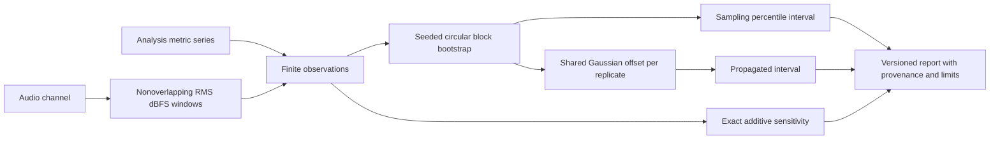

# Uncertainty Of Metric-Series Means

`esl uncertainty INPUT` computes deterministic bootstrap intervals for the
arithmetic mean of each selected series. It also propagates a user-specified
shared Gaussian additive offset and reports the exact sensitivity to that offset.
This is a bounded model, not complete measurement uncertainty, an instrument
calibration procedure, or uncertainty for every underlying analysis algorithm.

```sh
esl uncertainty analysis.json --metric rms_dbfs --block-size 8 \
  --resamples 2000 --seed 42 --offset-std rms_dbfs=0.5 \
  --sensitivity-step rms_dbfs=1 --output intervals.json
esl uncertainty recording.wav --window-seconds 1 --channel 0 \
  --block-size 4 --resamples 1000 --output intervals.json
```

## Observations

JSON input must contain `metrics.NAME.series`, a one-dimensional list of finite
numbers. `units` are copied without conversion. Repeat `--metric NAME` to select
metrics; otherwise all metrics are selected. Summary-only inputs, nulls, booleans,
nonfinite observations, missing metrics, and empty series fail; they are never
silently filtered. Truncated/downsampled series quantify only the supplied
observations, not the original unsaved recording.

Non-JSON input is read by SoundFile in complete, nonoverlapping windows. The
selected zero-based channel is reduced to window RMS in dBFS. Partial final
windows are discarded and their sample count is recorded. At least two complete
windows are required. There is no cross-channel pooling, frequency weighting,
resampling, or SPL calibration. Silence is floored at -240 dBFS and this convention
is recorded in source metadata. Unsupported decoder formats fail explicitly.

`window_dbfs = 10 * log10(max(mean(samples_squared), 1e-24))`, where samples are
SoundFile's floating-point channel amplitudes relative to digital full scale,
mean averages one complete window, and the power floor avoids negative infinity.
The reported estimate is the arithmetic mean of window dB values. It is **not** an
energy-averaged equivalent sound level (Leq).

## Bootstrap And Propagation

The implementation uses circular fixed-length block resampling. For each
replicate, randomly choose starts uniformly from the series, collect consecutive
blocks wrapping around the end, concatenate, and truncate to the original series
length. Then calculate the replicate arithmetic mean. `--block-size 1` reduces to
IID resampling, which assumes independent observations. Longer blocks can retain
local dependence; choose them based on acquisition times and correlation scale.
No automatic block-length selection is performed. Wrapping assumes approximate
stationarity and is inappropriate across arbitrary regime boundaries.

`sampling_interval = [Q(alpha), Q(1-alpha)]`, where Q is the linearly interpolated
quantile of the bootstrap means and `alpha = (1-confidence)/2`.
`--confidence` defaults to 0.95. This is the percentile approach, not BCa or a
simultaneous interval over metrics. See [SciPy's bootstrap method documentation](https://docs.scipy.org/doc/scipy/reference/generated/scipy.stats.bootstrap.html)
and the [R boot time-series bootstrap documentation](https://stat.ethz.ch/R-manual/R-devel/library/boot/html/tsboot.html)
for percentile inference and fixed-block bootstrap background. Our circular
implementation is explicit above and does not call those libraries' bootstrappers.

`propagated_mean = bootstrap_mean + epsilon`, where epsilon is one independent
normal random draw per replicate with mean zero and standard deviation supplied
by `--offset-std METRIC=VALUE`. This draw is shared across the observations within
a replicate: systematic error does not shrink with observation count. The
propagated interval uses quantiles of these propagated means. With no offset
standard deviation, the two intervals are identical. This probabilistic output
combines resampling variability with the assumed offset distribution; it is not
an unconditional coverage guarantee.

`mean_with_offset = mean + offset`, where offset is in the same units as the
metric. The exact derivative with respect to offset is 1. The sensitivity output
shows `mean - step` and `mean + step`, where step is supplied with
`--sensitivity-step METRIC=VALUE` (default 1 metric unit). This is additive-offset
sensitivity only, **not** sensitivity to frame settings, arbitrary model parameters,
or a nonlinear recalculation of acoustic metrics. A dB offset can model dB-domain
gain uncertainty, but the software does not infer that uncertainty from a profile.
Offsets across metrics are independent; covariance, correlated calibration errors,
model error, and multivariate derived quantities are not propagated.

## Reproducibility And Bounds

Output contains `artifact_kind: esl.uncertainty.mean_intervals`, workflow schema
`1.0.0`, software/NumPy versions, SHA-256 input hash, source metadata, complete
configuration, sample counts, warnings, intervals and empirical standard errors.
Source is hashed again before output to detect mutation. Seeded NumPy generation
and name-derived metric seeds keep results stable across metric selection/order
for identical inputs and library versions. `--seed` must be nonnegative.

Limits are 2..1,000,000 observations per series, 100..100,000 replicates, and
50,000,000 resampled values per metric. Audio reads at most 10,000,000 channel
samples per window. JSON itself is loaded in memory; this is not an out-of-core
JSON reader. Bootstrap memory is proportional to one series plus replicate count,
not all replicates times series length. Total cost scales with selected metrics.
If a bound is exceeded, reduce replicate count or externally prepare a justified
window series; the workflow never silently subsamples.

Constant series and fewer than ten blocks produce warnings. Finite intervals do
not establish coverage for small samples, nonstationarity, inappropriate blocks,
or unrepresentative recordings. Interval width is not a quality or safety score.
`--output PATH` writes JSON, otherwise JSON goes to stdout. Parent directories must
exist and output should differ from input. Success exits 0; invalid input exits 1
through the main CLI.



## Python Integration

```python
from esl.workflows.uncertainty import bootstrap_mean, register

result = bootstrap_mean([1.0, 2.0, 3.0, 4.0], seed=42,
                        resamples=2000, block_size=2,
                        offset_std=0.5, sensitivity_step=1.0)
# Parent CLI: register(subparsers)
```
